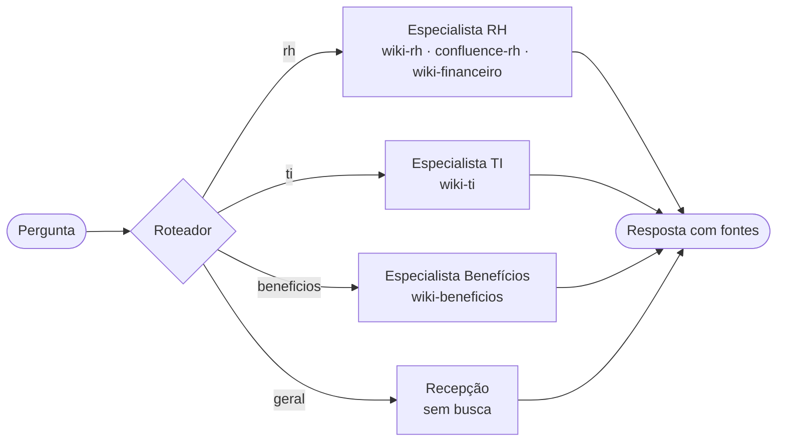

# Nota de arquitetura · Encontro 4

**Equipe:**
**Integrantes:**

> Uma página. A pergunta é uma só: **a divisão em vários agentes se paga no caso da Aurora?** Decidir **não** dividir, com números, é uma resposta tão válida quanto dividir.

## 1. O padrão escolhido

<!-- Nomeie o padrão: agente único com ferramentas, roteador + especialistas, ou supervisor + especialistas.
     Diga a configuração: roteador (llm ou regra), equipe (3 ou 4), handoff, o que fazer quando o roteador está incerto. -->

**Padrão:**

**Configuração:**

## 2. O diagrama

<!-- Ajuste o diagrama ao padrão escolhido. O GitHub desenha blocos mermaid sozinho.
     Mostre quem chama quem e que espaços da wiki cada agente enxerga. -->



## 3. O placar

<!-- Cole aqui a tabela que o Passo 4 do notebook 02 imprime. Precisa ter a linha de base (agente único)
     e pelo menos duas configurações. -->

| arquitetura | acertos | rota certa | chamadas/caso | tokens/caso | custo total (US$) | custo/acerto (US$) | seg/caso |
|---|---|---|---|---|---|---|---|
|  |  |  |  |  |  |  |  |

## 4. A divisão se paga?

<!-- Três a cinco frases. Respondam com números do placar:
     - O acerto subiu, caiu ou ficou igual em relação ao agente único? E o custo por acerto?
     - O limite entre os especialistas é real (fonte, permissão, ferramenta próprias) ou é só um prompt diferente?
     - Que exigência do caso a divisão atende, ou deixa de atender (controle de acesso por fonte, auditabilidade)? -->

## 5. Um caso, aberto

<!-- O caso do Passo 3 do notebook 02. -->

**Caso:**
**Causa:** rota errada · handoff perdeu informação · pergunta de duas áreas · parede funcionando · só custo
**A linha do trace que mostra a causa:**

```
(cole aqui)
```

## 6. Para o domínio da equipe (opcional)

<!-- Só para quem trocou o caso pelo domínio da própria empresa: em duas ou três frases, onde ficariam
     os limites entre especialistas no domínio de vocês, e que fonte cada um poderia ou não enxergar. -->
