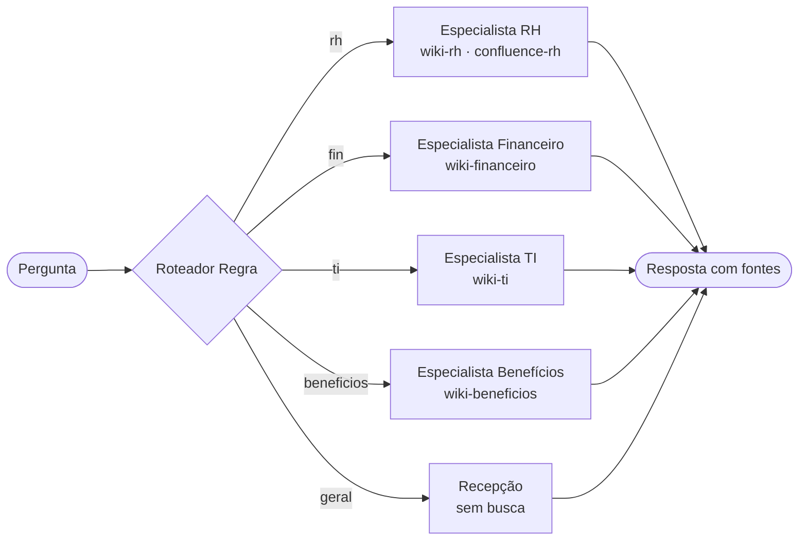

# Nota de arquitetura · Encontro 4

**Equipe:**
**Integrantes:**

> Uma página. A pergunta é uma só: **a divisão em vários agentes se paga no caso da Aurora?** Decidir **não** dividir,
> com números, é uma resposta tão válida quanto dividir.

## 1. O padrão escolhido

<!-- Nomeie o padrão: agente único com ferramentas, roteador + especialistas, ou supervisor + especialistas.
     Diga a configuração: roteador (llm ou regra), equipe (3 ou 4), handoff, o que fazer quando o roteador está incerto. -->

**Padrão:**
roteador regra

**Configuração:**
roteador regra · 4 esp · original · incerto→segue

## 2. O diagrama

<!-- Ajuste o diagrama ao padrão escolhido. O GitHub desenha blocos mermaid sozinho.
     Mostre quem chama quem e que espaços da wiki cada agente enxerga. -->



## 3. O placar

<!-- Cole aqui a tabela que o Passo 4 do notebook 02 imprime. Precisa ter a linha de base (agente único)
     e pelo menos duas configurações. -->

| arquitetura                                       | acertos | rota certa | chamadas/caso | tokens/caso | custo total (US$) | custo/acerto (US$) | seg/caso |
|---------------------------------------------------|---------|------------|---------------|-------------|-------------------|--------------------|----------|
| agente único (Aula 3)                             | 16/19   | 17/17      | 2.6           | 3007        | 0.0655            | 0.00409            | 2.7      |
| roteador llm · 3 esp · original · incerto→segue   | 16/19   | 14/17      | 3.1           | 2588        | 0.0599            | 0.00375            | 3.2      |
| roteador regra · 3 esp · original · incerto→segue | 16/19   | 14/17      | 2.0           | 2279        | 0.0506            | 0.00316            | 2.1      |
| roteador llm · 3 esp · resumo · incerto→segue     | 16/19   | 14/17      | 3.1           | 2581        | 0.0598            | 0.00374            | 3.1      |
| roteador llm · 3 esp · original · incerto→único   | 15/19   | 14/17      | 3.5           | 3298        | 0.0741            | 0.00494            | 3.5      |
| roteador regra · 4 esp · original · incerto→segue | 17/19   | 15/17      | 1.7           | 1360        | 0.0326            | 0.00192            | 1.9      |
| roteador regra · 4 esp · original · incerto→único | 15/19   | 16/17      | 2.6           | 3059        | 0.0667            | 0.00444            | 2.7      |
| roteador regra · 3 esp · original · incerto→único | 15/19   | 16/17      | 2.6           | 3081        | 0.0669            | 0.00446            | 2.6      |
| roteador llm · 3 esp · resumo · incerto→único     | 15/19   | 14/17      | 3.5           | 3291        | 0.074             | 0.00493            | 3.4      |
| supervisor · 3 esp                                | 17/19   | 15/17      | 3.9           | 3370        | 0.079             | 0.00465            | 4.2      |
| roteador llm · 4 esp · original · incerto→segue   | 16/19   | 14/17      | 3.1           | 2576        | 0.06              | 0.00375            | 3.3      |
| supervisor · 4 esp                                | 16/19   | 14/17      | 4.4           | 4218        | 0.0957            | 0.00598            | 4.7      |

## 4. A divisão se paga?

<!-- Três a cinco frases. Respondam com números do placar:
     - O acerto subiu, caiu ou ficou igual em relação ao agente único? E o custo por acerto?
     - O limite entre os especialistas é real (fonte, permissão, ferramenta próprias) ou é só um prompt diferente?
     - Que exigência do caso a divisão atende, ou deixa de atender (controle de acesso por fonte, auditabilidade)? -->

## 5. Um caso, aberto

<!-- O caso do Passo 3 do notebook 02. -->

**Caso:**
**Causa:** rota errada · handoff perdeu informação · pergunta de duas áreas · parede funcionando · só custo **A linha do
trace que mostra a causa:**

```
(cole aqui)
```

## 6. Para o domínio da equipe (opcional)

<!-- Só para quem trocou o caso pelo domínio da própria empresa: em duas ou três frases, onde ficariam
     os limites entre especialistas no domínio de vocês, e que fonte cada um poderia ou não enxergar. -->
